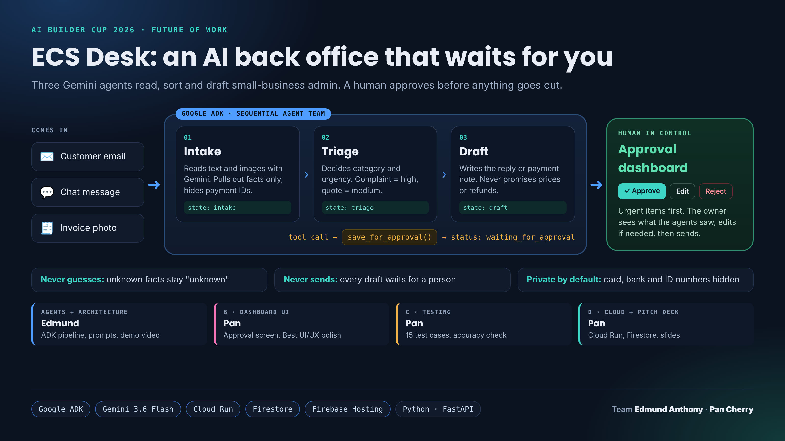

# ECS Desk

**An AI back office that waits for you.** Three Gemini agents read, sort and draft small-business admin (emails, chat messages, invoice photos). A human approves before anything goes out.

Built for the **AI Builder Cup 2026** (Future of Work & Enterprise Productivity) by Edmund Anthony and Pan Cherry.



## How it works

| Step | Agent | What it does |
|---|---|---|
| 1 | **Intake** | Reads text and images with Gemini. Extracts facts only; hides card, bank and ID numbers. |
| 2 | **Triage** | Decides category (complaint, quote, booking, invoice, other) and urgency. |
| 3 | **Draft** | Writes the reply or internal note, then calls `save_for_approval()`. |
| 4 | **Human** | Reviews in the dashboard: Approve, Edit or Reject. Nothing is sent automatically. |

Built with Google ADK (`SequentialAgent`), Gemini 3.6 Flash, FastAPI, and (next) Firestore + Cloud Run.

## Run locally (Windows PowerShell)

```powershell
python -m venv .venv
.\.venv\Scripts\Activate.ps1
pip install -r requirements.txt
copy env.example ecs_desk\.env     # then open ecs_desk\.env and paste your own Gemini API key
python desk_server.py              # dashboard at http://127.0.0.1:8080
# or: adk web                      # ADK developer UI at http://127.0.0.1:8000
```

## Project layout

```
ecs_desk/agent.py    the 3 agents + save_for_approval tool
desk_server.py       web app: runs the agents, approve/reject API
desk.html            approval dashboard
docs/                architecture diagram
```

## Safety rules built into the agents

- **Never guesses:** facts not visible stay "unknown".
- **Never sends:** every draft waits for a person.
- **Never promises:** no prices, refunds, discounts or confirmed bookings in drafts.
- **Private by default:** card, bank, UEN and ID numbers are replaced with `[hidden]`.
