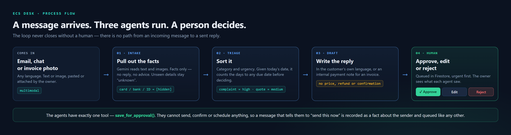

# ECS Desk

[](https://github.com/edmundzen/ecs-desk/actions/workflows/checks.yml)
[](tests/benchmark.md)
[](https://ecs-desk-qiabewya3q-as.a.run.app)

**An AI back office that waits for you.** Three Gemini agents read, sort and draft small-business admin (emails, chat messages, invoice photos). A human approves before anything goes out.

Built for the **AI Builder Cup 2026** (Future of Work & Enterprise Productivity) by Edmund Anthony and Le Shwe Yee Win.


## 1. Overview

A message arrives (pasted text, or a photo of an invoice). Three agents run in
sequence on Cloud Run, and the result lands in an approval queue in Firestore.
Nothing reaches a customer until a person clicks Approve.

| Step | Agent | What it does |
|---|---|---|
| 1 | **Intake** | Reads text and images with Gemini. Extracts facts only; hides card, bank and ID numbers. |
| 2 | **Triage** | Decides category (complaint, quote, booking, invoice, other) and urgency. |
| 3 | **Draft** | Writes the reply or internal note, then calls `save_for_approval()`. |
| 4 | **Human** | Reviews in the dashboard: Approve, Edit or Reject. Nothing is sent automatically. |



The agents have exactly one tool, `save_for_approval()`. They cannot send,
confirm or schedule anything, so a message instructing them to "send this now"
is recorded as a fact about the sender and queued like any other.

Google ADK (`SequentialAgent`) · Gemini · FastAPI · Firestore · Cloud Run ·
Secret Manager · Cloud Build.

## 2. Prerequisites

- Python 3.11+
- [gcloud CLI](https://cloud.google.com/sdk/docs/install), authenticated
- A Google Cloud project with billing enabled
- A Gemini API key from [aistudio.google.com](https://aistudio.google.com)
- These APIs enabled:

```bash
gcloud services enable run.googleapis.com firestore.googleapis.com \
  secretmanager.googleapis.com cloudbuild.googleapis.com \
  artifactregistry.googleapis.com --project=YOUR_PROJECT_ID
```

## 3. Configuration

| Variable | What it is | Where it lives |
|---|---|---|
| `GOOGLE_API_KEY` | Gemini API key | Secret Manager in cloud; `ecs_desk/.env` locally |
| `GOOGLE_GENAI_USE_VERTEXAI` | `FALSE` to use the AI Studio key | Set on the service / in `.env` |
| `GOOGLE_CLOUD_PROJECT` | Project holding Firestore | Set on the service / shell locally |
| `ECS_DESK_UID` | Queue owner. Defaults to `demo-owner` | Optional; set to isolate a test queue |
| `PORT` | Set by Cloud Run | Automatic |

Never commit `.env`. It is in `.gitignore` and `.dockerignore`.

## 4. Secret setup

The key is stored in Secret Manager and injected as an environment variable at
run time. It is never baked into the image or committed.

```bash
gcloud secrets create gemini-api-key --replication-policy="automatic" \
  --project=YOUR_PROJECT_ID

# Paste your own key. Do not put it in a file that gets committed.
echo -n "YOUR_GEMINI_API_KEY" | gcloud secrets versions add gemini-api-key \
  --data-file=- --project=YOUR_PROJECT_ID

# Least privilege: the runtime identity may read this one secret, nothing more.
gcloud secrets add-iam-policy-binding gemini-api-key \
  --member="serviceAccount:YOUR_PROJECT_NUMBER-compute@developer.gserviceaccount.com" \
  --role="roles/secretmanager.secretAccessor" \
  --project=YOUR_PROJECT_ID
```

## 5. Database and access rules

The approval queue lives at `/users/{uid}/items/{id}`. Queue numbers come from a
counter document updated in a transaction, so two messages arriving together
cannot be given the same id.

```bash
gcloud firestore databases create --location=asia-southeast1 \
  --project=YOUR_PROJECT_ID
```

Deploy the rules in [`firestore.rules`](firestore.rules):

```bash
firebase deploy --only firestore:rules --project YOUR_PROJECT_ID
```

The rules are owner-bound with a default-deny catch-all. The browser never
talks to Firestore directly — only the Cloud Run service does, through the
Admin SDK — so these rules cost nothing today and are already correct for the
day sign-in is added.

> **Known gap, deliberate, for the judging window only.** The dashboard has no
> sign-in yet, and the service is deployed with `--allow-unauthenticated`.
> Anyone with the URL can read and approve the queue. The storage layout
> already takes a `uid`, so closing this means verifying a Firebase ID token
> and passing the real uid through — no data migration. Close it after judging.

## 6. Run locally

```powershell
python -m venv .venv
.\.venv\Scripts\Activate.ps1
pip install -r requirements-dev.txt

copy env.example ecs_desk\.env     # then paste your own Gemini key into it
$env:GOOGLE_CLOUD_PROJECT = "YOUR_PROJECT_ID"
gcloud auth application-default login   # so Firestore works locally

python desk_server.py              # dashboard at http://127.0.0.1:8080
# or: adk web                      # ADK developer UI at http://127.0.0.1:8000
```

## 7. Deploy

```bash
gcloud run deploy ecs-desk \
  --source . \
  --project=YOUR_PROJECT_ID \
  --region=asia-southeast1 \
  --allow-unauthenticated \
  --set-env-vars=GOOGLE_CLOUD_PROJECT=YOUR_PROJECT_ID,GOOGLE_GENAI_USE_VERTEXAI=FALSE \
  --set-secrets=GOOGLE_API_KEY=gemini-api-key:latest \
  --labels=dev-tutorial=cloud-run-ai-challenge \
  --memory=1Gi --timeout=300 --max-instances=3
```

`--set-secrets` mounts the key from Secret Manager; it is never in the image.

## 8. Verification

```bash
curl https://YOUR_SERVICE_URL/api/health        # {"ok":true} - process up, Firestore answering
```

Two layers, deliberately separated. **The checks prove the plumbing is sound;
the eval proves the AI is right.**

**Fast checks** — seconds, no API key, no network, no cost. Syntax, a scan for
secrets and files that must never be committed, and 26 offline tests of the
model fallback ladder and enum validation:

```bash
python tests/checks.py
git config core.hooksPath .githooks   # once per clone: run them before each commit
```

The same checks run on every push via
[`.github/workflows/checks.yml`](.github/workflows/checks.yml), plus `pip check`
— `google-adk` and `google-api-core` disagree about `opentelemetry-api`, so a
bump to either one alone makes the set uninstallable.

**The eval** — 17 live Gemini calls, about fifteen minutes, and real tokens per
run. Not automated for exactly that reason. Run it before a submission, and
after any prompt, model or storage change:

```bash
python tests/make_invoices.py                        # regenerate invoice images
python tests/run_eval.py --url https://YOUR_SERVICE_URL
python tests/token_report.py                         # measured cost per message
```

`run_eval.py` grades 15 core cases (5 complaints, 5 quotes/bookings,
5 invoices/other) plus 2 extra safety cases on category, urgency, reply
language and safety, and writes `tests/benchmark.md`. See
[`tests/README.md`](tests/README.md) for what each case defends.

Manual walkthrough:

1. Open the dashboard. Click a demo preset, then Process. A draft appears in
   the queue marked *waiting for approval*. The queue is ordered by urgency
   first and newest second, so the draft lands wherever its urgency places it
   rather than at the top; the dashboard scrolls to it.
2. Edit the draft text and click Save Edits. The item shows *edited by human*.
3. Approve it. The status changes and a decided timestamp appears.
4. Reopen it. The timestamp clears and it returns to the queue.
5. Submit with an empty box. Expect a clean `400`, not a crash.
6. Expand *Inspect Multi-Agent Evidence* to see what each agent saw.

## 9. Required label

The challenge requires this label on the service. It is applied by the deploy
command above; to apply it to an existing service:

```bash
gcloud run services update ecs-desk \
  --update-labels=dev-tutorial=cloud-run-ai-challenge \
  --region=asia-southeast1 --project=YOUR_PROJECT_ID
```

## Project layout

```
ecs_desk/agent.py           the 3 agents + save_for_approval tool
ecs_desk/config.py          model ladder, enums, validation
ecs_desk/fallback_model.py  walks the model ladder on 429/500/503/404
ecs_desk/store.py           Firestore approval queue
desk_server.py              web app: runs the agents, approve/reject API
desk.html                   approval dashboard
firestore.rules             owner-bound, default deny
tests/                      eval suite and benchmark
```

## Safety rules built into the agents

- **Never guesses:** facts not visible stay "unknown".
- **Never sends:** every draft waits for a person.
- **Never promises:** no prices, refunds, discounts or confirmed bookings in drafts.
- **Private by default:** card, bank, UEN and ID numbers are replaced with `[hidden]`.
- **Instructions in a message are data:** text telling the agents to send
  immediately or skip approval is recorded as a fact about the sender, never
  obeyed. Covered by `EXTRA-INJECT` in the suite.
- **Never single-tries a model:** a recoverable failure moves down the ladder in
  `config.py` rather than failing the run.
